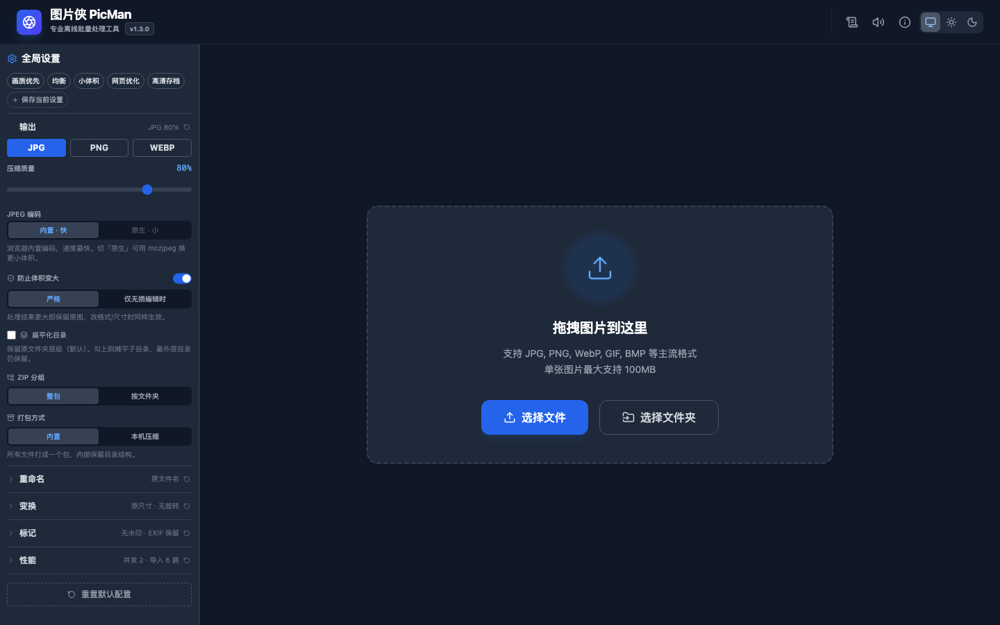

# 🖼️ PicMan 图片侠

**一款强大的离线批量图片处理工具**<br/>
**A powerful offline batch image processing tool**

[](https://github.com/tenoz/PicMan/releases)
[](https://github.com/tenoz/PicMan)
[](LICENSE)

<p align="center">
  
</p>

---

## 简介 | Introduction

**PicMan 图片侠** 是一款离线批量图片处理工具，所有操作本地完成——不联网、不上传，图片不离开你的电脑。

- 💾 **内存不随张数涨**：处理结果直接落盘，一千张也不会把内存吃满（v1.3.0 起）
- 🚀 纯前端架构，无需后端、无需服务
- 🔒 本地离线处理，隐私安全
- ⚡ 批量队列调度，可暂停 / 继续 / 终止
- 🖥️ 优先做桌面应用，浏览器里也能跑

> **v1.3.0 的重点是内存**：以前 1000 张要吃掉几个 G，靠预算硬撑、撑不住就丢结果；
> 现在产物写进磁盘工作目录，内存里只留正在处理的那几张。

---

## ✨ 功能特性

| 功能 | 说明 |
|------|------|
| 🔄 格式转换 | JPG / PNG / WebP 互转 |
| 📐 尺寸调整 | 按比例缩放或固定宽 / 高 |
| 🎨 自定义水印 | 文字水印，位置与透明度可调 |
| 🔄 旋转翻转 | 旋转与水平 / 垂直翻转 |
| 📋 EXIF 管理 | 保留或剥离元数据 |
| 🏷️ 批量重命名 | 前缀 / 后缀 / 查找替换 / 序号（起始值、位数、连接符）/ 只用序号 |
| 🎛️ 配置预设 | 画质优先 / 均衡 / 小体积 / 网页优化 / 高清存档，可存自己的 |
| ⚡ 批量处理 | 可暂停 / 继续 / 终止，支持整文件夹导入与去重 |
| 📊 进度可见 | 跑完停在原地报结果：成功 / 跳过 / 失败 / 耗时，有失败转琥珀色 |
| 📦 打包导出 | ZIP 打包或直接写入目录；可扁平化目录、按文件夹分包 |
| 🌓 外观三态 | 跟随系统 / 始终亮 / 始终暗 |
| 🖼️ 原生编码 | 桌面端可选走 Rust 的 mozjpeg / oxipng，体积更小（默认关） |

---

## 📥 安装

### 桌面应用（推荐）

从 [Releases](https://github.com/tenoz/PicMan/releases) 下载 DMG：

- `PicMan_1.3.0_aarch64.dmg` — Apple Silicon（M1/M2/M3…）
- `PicMan_1.3.0_x64.dmg` — Intel Mac

系统要求 **macOS 11.0 或更高**。首次打开若提示「Apple 无法检查是否包含恶意软件」，
到 *系统设置 → 隐私与安全 → 仍要打开*，或执行：

```bash
xattr -d com.apple.quarantine /Applications/PicMan.app
```

### 浏览器使用

浏览器版要从源码跑（见下方「从源码构建」），桌面端的部分能力（原生编码、本机打包）不可用。

> 别双击 `index.html` 打开——这是 Vite + ES module 项目，`file://` 协议下跑不起来，只会看到白屏。

### 从源码构建

```bash
git clone https://github.com/tenoz/PicMan.git
cd PicMan
npm install

npm run dev          # 开发模式，localhost:3000
npm run bundle       # 打包 Apple Silicon
npm run bundle:x64   # 打包 Intel
npm run bundle:all   # 两个架构都打
```

产物在 `releases/`，脚本会自动打印 md5 / sha256。

> 打包走的是 `scripts/build-dmg.sh`，不是 tauri 原生的 dmg 流程——原因见 `AGENTS.md` 坑 37。

---

## 🚀 使用方法

1. **导入** — 拖拽或点击导入图片，支持整个文件夹
2. **配置** — 选格式、质量、尺寸、水印、重命名规则，或直接点一个预设
3. **处理** — 点开始，可随时暂停 / 继续 / 终止
4. **导出** — ZIP 打包，或直接写入指定目录

---

## 🛠️ 技术栈

React 19 · TypeScript · Tailwind CSS v4 · Vite · Tauri 1.8 · Canvas API · Rust（可选编码器）

图片处理走浏览器 Canvas，桌面端在此之上接了 Rust 的 mozjpeg（JPEG）与 oxipng（PNG）做可选的原生编码。
体积比对：同一个 3000×2000 的 JPEG，原生编码约小 44%，单张慢约 6 倍——大批量靠并行才划算，所以默认关闭。

---

## 📝 更新日志

- 版本变更：[CHANGELOG.md](CHANGELOG.md)
- 安装包与逐版说明：[Releases](https://github.com/tenoz/PicMan/releases)

---

## 📄 许可证 | License

本项目采用 [MIT](LICENSE) 许可证。

This project is licensed under the [MIT](LICENSE) License.

---

<div align="center">

**Made with ❤️ for efficient image processing**

</div>
